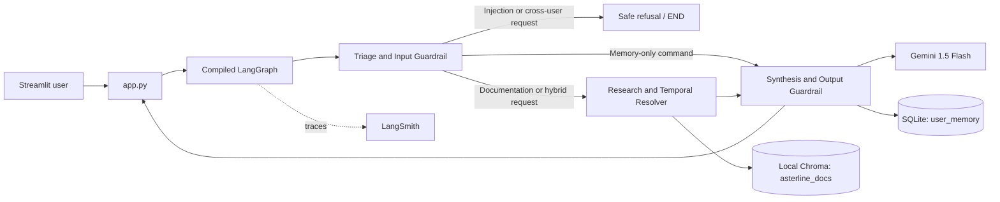

# Asterline Research Assistant Design

## 1. Architectural Overview

The assistant is a local-first retrieval-augmented research application. Its immutable company corpus is indexed into local Chroma storage, while SQLite holds only personal workspace preferences. A compiled LangGraph state machine coordinates three focused functional agents.



`triage_node` loads only the caller's personal context, rejects hostile or cross-user requests, and recognizes memory commands. `research_node` retrieves six candidate chunks from the local `asterline_docs` Chroma collection and ranks their authority. `synthesis_node` executes permitted memory commands or prompts Gemini using only retrieved documentation as factual evidence. It then removes unverified citations and credential-like strings before returning a response.

The application starts with:

```powershell
streamlit run app.py
```

## 2. Epistemic Separation & Memory Isolation

`asterline_memory.db` contains a single `user_memory` table with a composite primary key of `(user_id, key)`. Every read, write, deletion, and clear operation includes the current `user_id` in its SQL predicate. This prevents one user from reading, overwriting, or deleting another user's preferences.

Memory is intentionally limited to user-claimed context such as workspace names, preferred tiers, or team sizes. It is not a source of company truth and is not inserted into Chroma. During synthesis, retrieved chunks are labeled as documentation, while SQLite values are explicitly presented as unverified personal context. If a user claims a capability that contradicts documentation, the response identifies the claim as personal context and grounds the company statement only in an evidence chunk.

The Streamlit sidebar displays and clears only the selected user's memory. Chat history is also scoped in the Streamlit session by user ID, preventing a user switch from displaying another user's conversation in the same browser session.

## 3. Temporal Conflict Resolution Strategy

The corpus describes multiple product and policy versions. Retrieval alone can surface stale chunks, so `research_node` ranks retrieved documents before synthesis using four signals:

1. Explicit known supersessions have highest priority: `handbook:1` outranks `oncall:0`, and `retention:0` outranks `security:1`.
2. Text that explicitly contains a supersession clause receives additional priority.
3. Numeric portions of `version` are compared as semantic-like version components.
4. ISO publication timestamps are compared as a final recency signal.

This strategy implements the corpus rule described by `faq:2`: explicit supersession wins, then a newer version and newer publication date are preferred. The resulting ranked documents are supplied to Gemini in order, but the model is also instructed to state that information is unannounced or undocumented where the evidence does not establish a fact.

## 4. Guardrail Implementation

The input guardrail checks for instruction-override phrases, jailbreak attempts, system-prompt requests, and requests for credentials or ingestion keys. It also rejects requests that explicitly target another user's profile. Such requests receive an `injection_blocked` intent and a direct safe refusal; they do not reach retrieval or generation.

The output guardrail has three layers:

- Gemini receives a strict grounding prompt requiring source chunk IDs for every factual company assertion.
- The post-processor retains only bracket citations whose IDs appear in the actual retrieved document set.
- A credential-pattern scrubber redacts values resembling API keys, passwords, tokens, or private keys.

If a research response has no valid citation after validation, the system replaces it with a citation-validation failure message rather than returning unsupported company claims. The Streamlit UI renders surviving IDs as grounding badges below each assistant response.

## 5. Observability & Failure Analysis

`graph.py` calls `load_dotenv()`, so `.env` supplies `LANGCHAIN_TRACING_V2=true`, `LANGCHAIN_PROJECT=asterline-research-assistant`, and LangSmith credentials. LangGraph and LangChain then emit node and model execution traces to that project when outbound access is available. The Streamlit diagnostics toggle exposes the current intent, retrieved chunk metadata, and tracing configuration without exposing API keys.

`eval_suite.py` runs six reproducible end-to-end checks and prints a table containing test name, PASS or FAIL, and latency, followed by a success-rate summary. The suite covers the current on-call stipend, current cold-storage retention, unlisted Enterprise pricing, Alice/Bob memory isolation, persistent forget behavior, and injection blocking. A benchmark failure identifies the failing assertion while allowing subsequent cases to run. The suite clears its Alice and Bob test memory in a `finally` block so repeat runs begin from a clean state.

Run the benchmark with:

```powershell
python eval_suite.py
```

In restricted environments, expected failure modes are unavailable Gemini or LangSmith network access. The table will record those research cases as failures with their error details, while local memory and triage cases remain independently diagnosable. This makes infrastructure failures distinguishable from grounding, isolation, and guardrail regressions.
